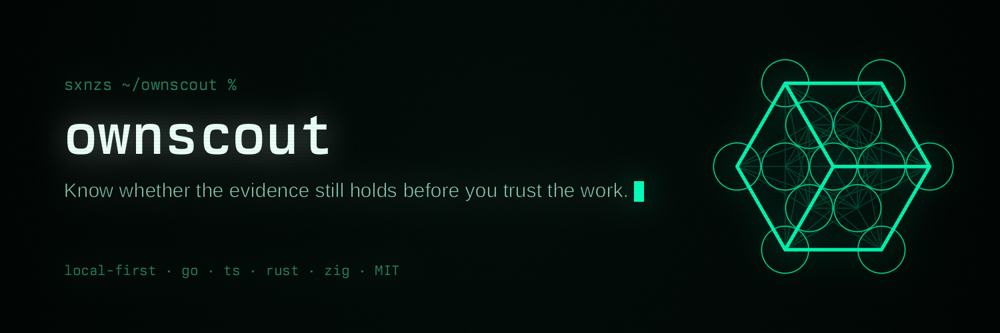
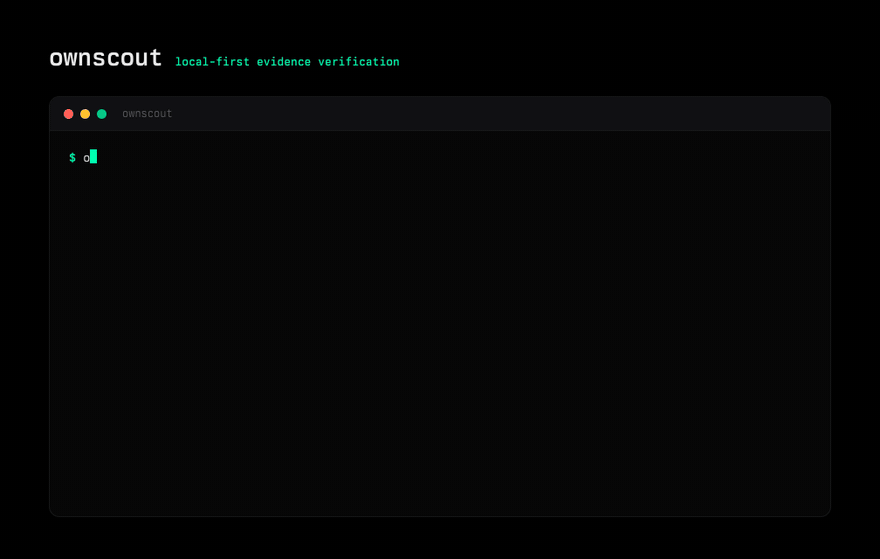
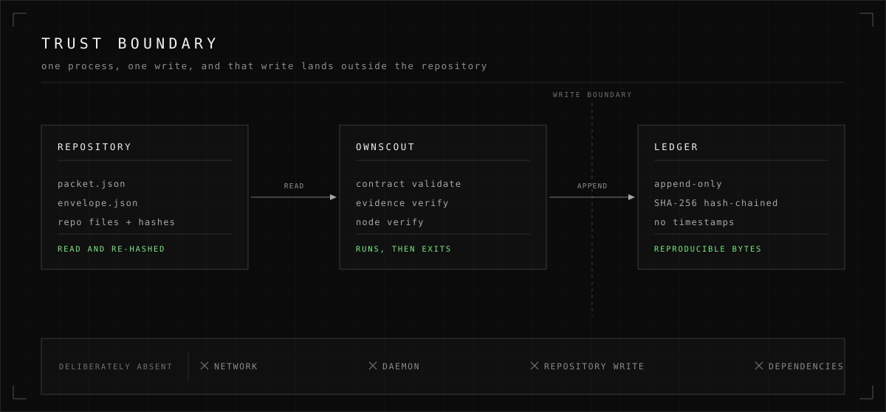
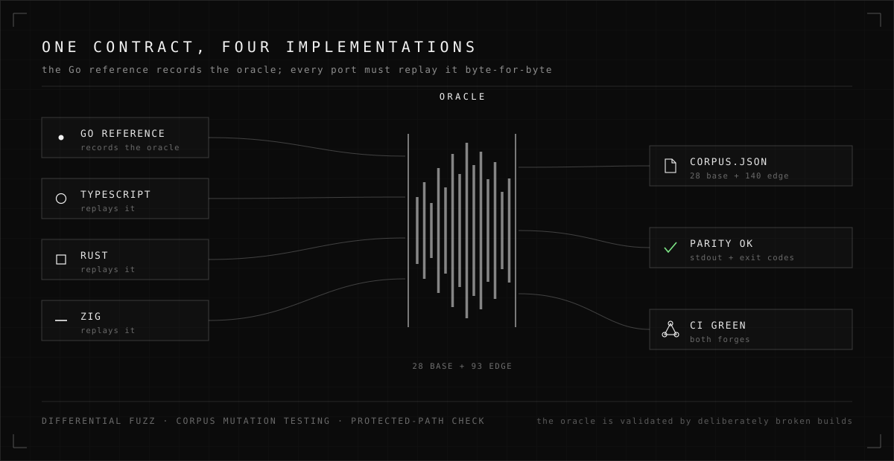

<p align="center">
  
</p>

<p align="center">
  <a href="LICENSE"></a>
  <a href="#install"></a>
  <a href="#verification"></a>
  <a href="#verification"></a>
</p>

An autonomous agent says it is done and hands you a packet: files touched, line
ranges, expected content hashes. But files change and branches move, so a hash
that was correct five minutes ago is now a lie. **OwnScout** is a small,
deterministic CLI that answers one question — *is this evidence still current in
this working tree, right now?* It validates the packet against a strict
contract, re-hashes the cited content, checks a dependency graph of work items,
and writes an append-only audit ledger. It never trusts the producer's own
claims.

<p align="center">
  
</p>

## Install

OwnScout is a single static binary with no runtime dependencies.

```bash
git clone https://github.com/void-shell/ownscout
cd ownscout
make build            # -> bin/ownscout
bin/ownscout doctor
```

For a release build, inject the version:

```bash
go build -ldflags "-X ownscout/internal/cli.version=v0.1.0" -o bin/ownscout ./cmd/ownscout
```

## Usage

| Command | Question it answers |
|---|---|
| `ownscout doctor` | Is this installation healthy and what version is it? |
| `ownscout contract validate --packet p.json` | Is this packet well-formed and internally consistent? |
| `ownscout evidence verify --repo R --packet p.json` | Is the cited content still byte-identical in `R`? |
| `ownscout node verify --repo R --packet p.json --envelope e.json --ledger L [--relocate]` | Does the whole dependency graph check out, and what is the audit trail? |
| `ownscout node bind --packet p.json` | What is this packet's canonical binding digest, for `packet_binding_sha256`? |
| `ownscout ledger verify --ledger L` | Is the ledger's hash chain intact, read-only? |
| `ownscout ledger rotate --ledger L` | Archive a validated ledger at its rotation point, named by its chain tip. |

Every command decodes packets through one shared strict decoder — no lenient
front door and strict back door: unknown fields are rejected, duplicate keys are
rejected, field names are exact case, trailing JSON is rejected, and there is a
1 MiB input limit. There is no compatibility normalisation and no silent hash
repair. **Fix the packet, do not ask the tool to reinterpret it.**

```bash
# Validate the packet contract alone.
ownscout contract validate --packet packet.json

# Verify that cited files still hash to the recorded values.
ownscout evidence verify --repo /path/to/repo --packet packet.json

# Same check, but a failure also reports where the content went.
ownscout evidence verify --repo /path/to/repo --packet packet.json --relocate

# Compute the binding digest an envelope must cite for this packet.
ownscout node bind --packet packet.json

# Check a dependency graph and append the ordered results to a ledger.
# --relocate adds evidence relocation diagnostics to failure details.
ownscout node verify --repo /path/to/repo --packet packet.json \
  --envelope envelope.json --ledger /path/to/ownscout-ledger.jsonl [--relocate]

# Audit a ledger's hash chain without locking or appending.
ownscout ledger verify --ledger /path/to/ownscout-ledger.jsonl

# Archive a validated ledger at its rotation point.
ownscout ledger rotate --ledger /path/to/ownscout-ledger.jsonl
```

Add `--json` to any validation command for a single machine-readable line.
Use it in scripts and agents; omit it when a person is diagnosing a failure.

### The safe workflow

Validate first, verify evidence second, and consume the packet only when both
succeed:

```bash
if ownscout contract validate --packet packet.json --json && \
   ownscout evidence verify --repo /path/to/repo --packet packet.json --json; then
  # The evidence is current; the packet may be consumed.
  :
else
  # Do not consume the packet.
  exit 1
fi
```

### When the evidence moved

A line range is a fragile way to cite code: insert a few lines above it and a
packet that was true five minutes ago now fails. `--relocate` searches the file
for a window of the same line count whose content hash matches the recorded one,
and names where it now lives. It distinguishes three honest outcomes — the
content moved, the content is not in this file, or the search stopped at its
budget — and it **never changes the verdict**: a moved span still fails, because
content that is no longer at the cited location is not current evidence. With
`--relocate` the failure simply tells you where to look. The worked example is
in [docs/EXPERIENCE.md](docs/EXPERIENCE.md#when-the-evidence-moved).

### Result shape

Every result has the same five fields, in this order. This is the `--json` line
for a packet whose budget counters contradict its evidence, pretty-printed:

```json
{
  "command": "contract validate",
  "ok": false,
  "summary": "packet is invalid (2 violation(s))",
  "details": [
    "budget: budget.used_evidence: used evidence exceeds max_evidence",
    "budget: budget.used_bytes: used bytes exceeds max_bytes"
  ],
  "next_action": "Fix the listed packet fields, then run contract validation again."
}
```

Violation ordering is part of the contract. Fixing the first item in `details`
is always the right next move.

### Exit codes

| Code | Meaning |
|---|---|
| `0` | Success: valid packet, or verified evidence. |
| `1` | Contract failure, evidence failure, or node graph failure after a successful ledger append. |
| `2` | Usage error, malformed input, missing file, repository/ledger I/O, or ledger append failure. |

A `1` after `node verify` means *the graph did not pass*, but the results
were still recorded — the ledger is audit history, never an authorisation.

## How it works

Three checks run in order, and each can stop the pipeline:

1. **Contract.** The packet is validated as packet-v1: required fields, exact
   case, outcome-to-action consistency, budget counters within limits, and at
   least one evidence entry for a complete packet. See
   [specs/packet-v1.md](specs/packet-v1.md).
2. **Evidence.** Every cited span is re-read from the working tree and re-hashed
   with SHA-256. A mismatch fails closed; nothing is repaired or reinterpreted.
3. **Graph.** `node verify` validates node-envelope-v1, evaluates the work
   items in deterministic order, and appends one record per run — including
   failed and blocked results.

Only the last step writes anything, and only to the explicit `--ledger` file,
which must live outside the repository. The ledger is capped at 1 MiB so
opening it stays a bounded whole-file validation. A full ledger is a rotation
point, not a failure: `ledger rotate` archives it as
`<ledger>.<first 8 of the chain tip>` and the next `node verify` starts a fresh
hash chain, while `ledger verify` audits each file independently. The full
semantics are in
[docs/EXPERIENCE.md](docs/EXPERIENCE.md#ledger-guidance).

### Trust boundary

- **No network.** Nothing is fetched, phoned home, or uploaded.
- **No daemon.** It runs, it exits.
- **No repository mutation.** Evidence files are read and re-hashed, never written.
- **The only write** is the explicit `--ledger` file, which must live *outside*
  the repository, is append-only, hash-chained with SHA-256, and contains no
  timestamps, so its bytes are reproducible.
- **No dependencies.** Go standard library only; the ports have empty dependency
  manifests.

<p align="center">
  
</p>

## Development

Run the reference check before anything else: it runs `go vet ./...`, the Go
test suite, and the corpus and documentation freshness checks.

```bash
make gate                       # the definition of done
```

### Language ports

This repository is also a study in **trace equivalence across languages**. The
Go implementation in `internal/` is the specification; three independent,
standard-library-only reimplementations reproduce its stdout, exit codes and
ledger bytes exactly.

<p align="center">
  
</p>

| Port | Binary | Build | Tests | Dependencies |
|---|---|---|---|---|
| TypeScript | `ports/ts/bin/ownscout` | none — Node 24 runs the source | 149 | none |
| Rust | `ports/rust/target/release/ownscout` | `cargo build --release` | 38 | none |
| Zig | `ports/zig/zig-out/bin/ownscout` | `zig build` | 37 | none |

Build the compiled ports and run everything:

```bash
make ports          # Rust + Zig binaries (TypeScript needs no build)
make ports-test     # each port's own test suite
spec/parity/verify-all.sh
```

The full guide is in [ports/README.md](ports/README.md); the contract every port
must satisfy is [spec/parity/PORT.md](spec/parity/PORT.md), and the recorded
status is [docs/PORTS.md](docs/PORTS.md). Design notes: [docs/DECISION.md](docs/DECISION.md)
records the v0 decision, and [docs/DELTADB.md](docs/DELTADB.md) maps OwnScout's
primitives to the DeltaDB ones it borrows from.

### Verification

A port is only interesting if a passing grade means something. Here is how
equivalence is established.

<p align="center">
  
</p>

- **Recorded traces.** The Go reference records 35 base cases and 249 hardening
  cases (path escape, non-UTF-8, graph cycles, ledger hash chaining, in-repo
  ledger rejection, JSON HTML-escaping, the null/empty field shapes, the
  raw-byte evidence shapes: invalid UTF-8 and CRLF in evidence files, a single
  empty selected line, and evidence files beyond 1 MiB, the anchor
  re-resolution outcomes: moved, absent, shrunken file, and budget-stopped, and
  the ledger JSON-walk structural rejections: duplicate keys flat and nested,
  unknown and case-folded fields, non-object records, trailing data, a missing
  final LF, blank lines, and node_results shape and per-result rules).
  Every port replays them byte-for-byte.
- **Mutation-tested traces.** Five deliberately broken reference builds fail
  the trace corpora (base 33/35, 25/35, 35/35, 35/35 and 33/35; edge 206/249, 124/249,
  247/249, 247/249 and 249/249 — fractions as recorded against the 35+249 corpus those builds
  faced), so a pass is evidence, not a formality. One mutant strips
  the `\r` of a `\r\n` pair while leaving its `\n`, a divergence no base case can
  see, which is why the edge trace corpus exists. The table is measured by
  `make mutants` and re-checked by `make mutants-check`, not typed by hand.
- **Differential fuzzing.** `spec/parity/fuzz.py` mutates the fixtures and
  compares the reference against a candidate. It is what caught a real shared
  defect in all three ports: an explicit JSON `null` for `evidence` or
  `degradations` must count as *absent* for the required-field rule but still
  trigger the "complete packet requires at least one evidence entry" rule.
- **Protected paths.** The verifier fails if anything outside `ports/` is
  modified, so a port lane cannot quietly patch the trace corpus.

Run it yourself:

```bash
make gate                       # Go reference tests + corpus freshness
spec/parity/status.sh           # compact per-port status
python3 spec/parity/fuzz.py --candidate ports/zig/zig-out/bin/ownscout --iterations 300
```

### Project layout

```
cmd/ownscout/        CLI entry point
internal/
  cli/               command surface, rendering, exit codes
  contract/          packet-v1 validation and violation ordering
  evidence/          path-safe re-hashing of cited content, anchor re-resolution
  node/              node-envelope graph validation and evaluation
  nodepacket/        strict packet-v1 decoding shared by all commands
  ledger/            append-only SHA-256 hash-chained ledger
ports/
  ts/  rust/  zig/   independent reimplementations
plans/               design notes, including the DeltaDB primitive study
spec/
  parity/            the recorded trace corpora, replay harness, verifier, fuzzer
specs/               packet-v1 and node-envelope-v1 documents
docs/
  assets/            the banner, hero GIF and diagrams used in this README
```

## License

[MIT](LICENSE) © Santiago Sainz
